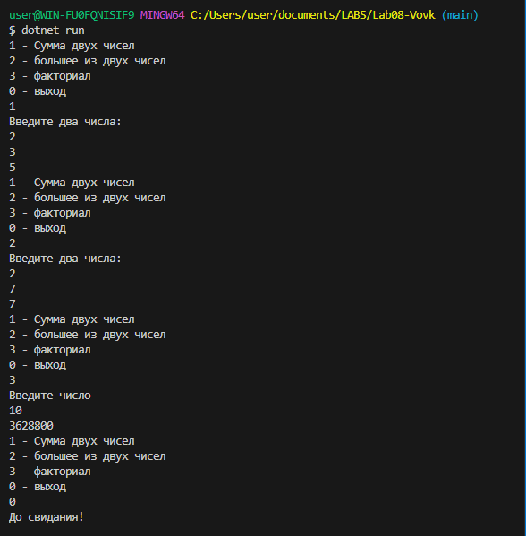
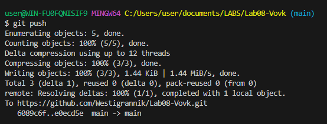

# Практическая работа №8
**ФИО: Вовк Тимофей Евгеньевич**
**Группа: ИСП-242**
**Дата:14.10.2026**
## Что изучено
- Изучили Методы
- Изучили разницу между метода с войдом и без
- Изучили использование метода с массивом

